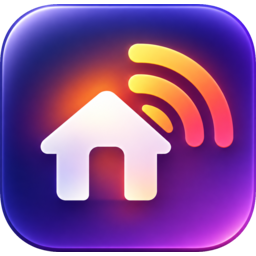

<p align="center"></p>

# EinCast

*Your home media, on every screen.* "Ein" (အိမ်) is Burmese for *home*.

A desktop app (macOS + Windows) that serves a folder of media over your LAN so TVs, iPads and phones can play it. Built with Go, Wails v2 and React.

> Status: **Phase 11 — several libraries (toward v1.0).** Choose a media folder, start the server, and open it from a TV, iPad or phone by scanning the QR code or typing the address; the page streams video, music and photos, and an M3U playlist works in VLC and Infuse. Add as many media folders as you like (Settings → Libraries). The Library screen lists, searches and sorts your files, across all of them or one at a time, shows thumbnails when `ffmpeg` is installed, and follows the folder by itself as you add or remove files. Remote access (Tailscale, Cloudflare, ngrok) is available behind an access PIN, and the Logs view shows everything the app does. Appearance can follow the system or be set to light or dark. The player page shows subtitles, remembers where you stopped on each device, and converts videos an iPhone or iPad can't play as they are. The server answers to `http://eincast.local:8765` on devices that support mDNS, and, if you turn on **Smart TVs** in Settings, shows up by itself in the media-server list of smart TVs and apps like VLC. The **access token is off by default**: until you turn it on in Settings, anyone on your Wi-Fi who knows the address can open the library while the server runs. Features land phase by phase (see [docs/ROADMAP.md](docs/ROADMAP.md)).

## Requirements

- Go 1.26+
- Node 20+ and npm
- [Wails v2 CLI](https://wails.io/docs/gettingstarted/installation) (`wails doctor` should report success)

## Run, build, test

```sh
wails dev                       # live-reloading dev window
wails build -ldflags "-X main.version=0.1.0"   # → build/bin/eincast.app

go test ./...                   # Go tests
scripts/check-deps.sh           # hexagonal dependency rules
scripts/check-cross.sh          # compiles for macOS and Windows; add --full for a complete Windows Wails build
scripts/make-icons.sh           # rebuilds every icon from build/logo.png (needs ImageMagick)
cd frontend && npm run typecheck && npm test
```

## Try the API

Choose a folder, press **Start server**, then open the **Connect a device** card. On the same machine, or any device on your network, use the address it shows (default port 8765):

```sh
curl http://127.0.0.1:8765/api/health
curl http://127.0.0.1:8765/api/library
curl -H "Range: bytes=0-99" -i http://127.0.0.1:8765/stream/<id>
curl http://127.0.0.1:8765/playlist.m3u      # open in VLC / Infuse
```

See [docs/ARCHITECTURE.md](docs/ARCHITECTURE.md) for the full route table.

## Settings, token and data

| What | Where |
|---|---|
| Port, display name, library folders (and their names), token on/off, Smart TVs on/off | `settings.json` in `~/Library/Application Support/EinCast` (macOS) or `%AppData%\EinCast` (Windows) |
| The access token | The system Keychain / Credential Manager, service `com.bkthomas.eincast`. Never in `settings.json` or the logs |

Thumbnails are made with `ffmpeg` if it is installed (for example `brew install ffmpeg`); without it EinCast shows icons instead. They are cached in `~/Library/Caches/EinCast/thumbs` (macOS) or `%LocalAppData%\EinCast\thumbs` (Windows) and are safe to delete. The Light/Dark/System choice is remembered by the app window itself.

Subtitles: put `.srt` (or `.vtt`) files next to the video with the same name, optionally with a language, e.g. `Film.mkv` and `Film.en.srt`. Pick one in the player's menu.

Videos a device can't play as they are (MKV, AVI, HEVC…) are converted on the fly with `ffmpeg` for Safari, iPhone, iPad and TVs that play HLS. Conversions are temporary files in `~/Library/Caches/EinCast/hls` (macOS) or `%LocalAppData%\EinCast\hls` (Windows), deleted when you stop watching and when EinCast quits.

Smart TVs (Settings → Smart TVs) is off by default. A TV can't send the access token, so while it is on the whole library is visible, without a password, to everyone on your network; it can't be on together with the access token.

If the server won't start because another program already holds its port, Settings → Free a port shows which program that is (using `lsof` on macOS, `netstat` on Windows) and ends it when you confirm. It never ends EinCast itself, and only offers ports 1024–65535.

Deleting `settings.json` resets EinCast to its defaults. A damaged one is moved to `settings.json.bad` and EinCast starts with defaults.

## Folder map

| Path | What lives there |
|---|---|
| `main.go` | Composition root: builds dependencies, configures the Wails window. No logic. |
| `internal/domain` | Pure types and rules. Imports nothing. |
| `internal/app` | Use cases, talking to the outside through small interfaces (ports). |
| `internal/adapters` | Implementations of those ports (filesystem, HTTP, logging, ...). |
| `internal/bridge` | The only package that may import Wails. Facade + DTOs for the frontend. |
| `frontend/src/app` | Layout shell: title bar, sidebar, view switching. |
| `frontend/src/features` | One folder per feature slice. |
| `frontend/src/shared` | Bridge to Go, glass UI kit, motion presets, helpers. |
| `build/` | Wails build assets. `logo.png` is the master logo; `appicon.png` and `windows/icon.ico` are generated from it. |
| `scripts/` | Repo tooling (`check-deps.sh`, `make-icons.sh`). |
| `docs/` | Architecture, roadmap, and decision records (`docs/adr`). |
