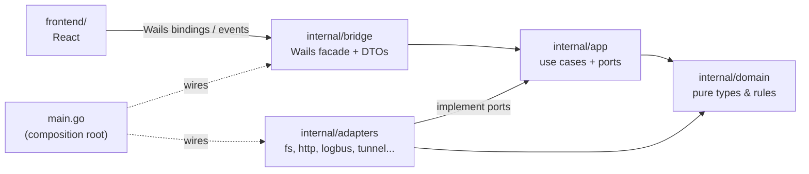

# Architecture

EinCast is a hexagonal (ports & adapters) application. See
[ADR 0001](adr/0001-hexagonal-architecture.md) for why.

## Layers

Arrows point in the direction of the import. `domain` imports nothing; `app`
never imports Wails, `net/http` or `os`. `scripts/check-deps.sh` fails if that
changes.

## What exists today (Phase 1)

Only `bridge` has code (`AppInfo`, to prove the Go ⇄ JS round trip). `domain`,
`app` and `adapters` are empty layers with package docs; the rules are already
enforced so later phases cannot erode them.

The sequence diagrams for "user clicks Start" and "iPad requests /stream/{id}"
are added in Phase 3, when there is a flow to draw.

## Frontend

Feature-sliced: `app/` (shell), `features/` (one folder per feature),
`shared/` (bridge, glass UI, motion). Only `shared/bridge` imports the
generated `wailsjs/` code (see [ADR 0006](adr/0006-bridge-only-wails-dependency.md)).
Theming is CSS-only via `prefers-color-scheme`.
