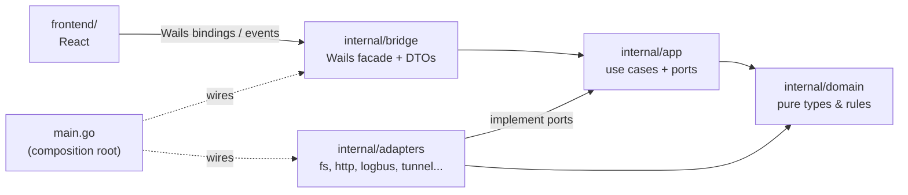
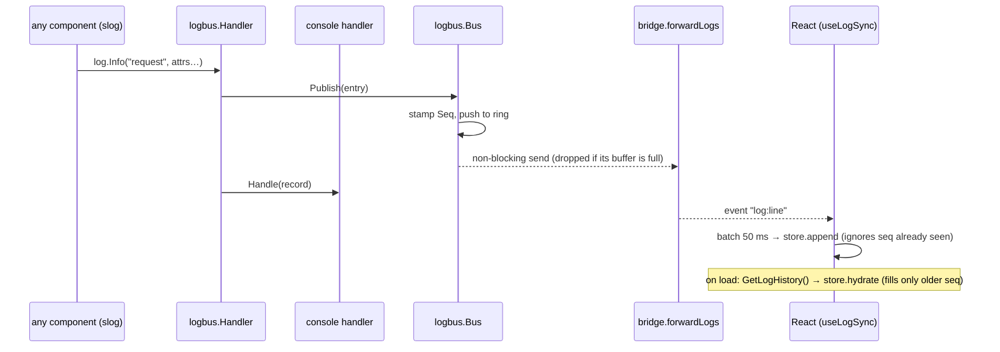
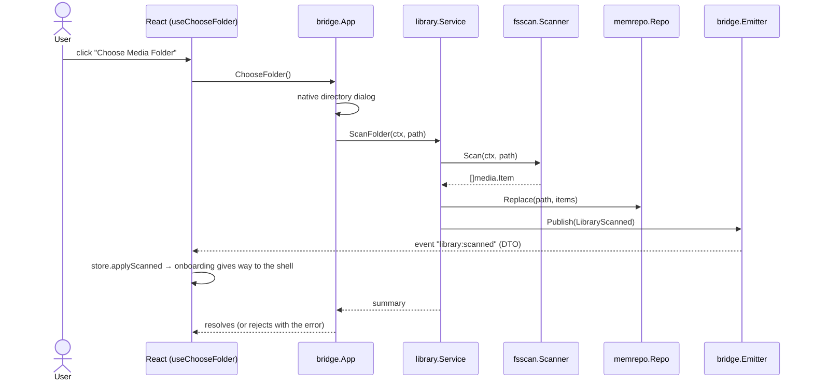
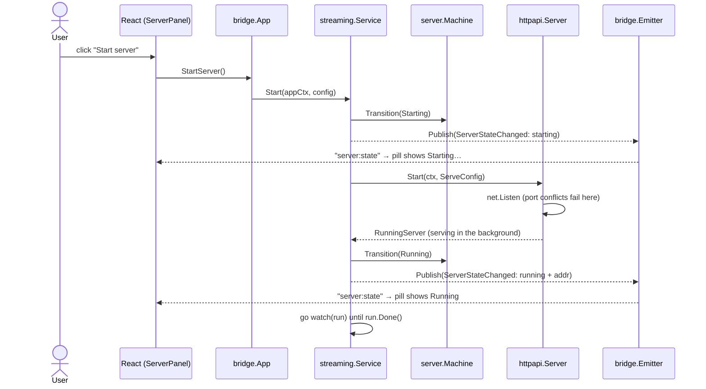
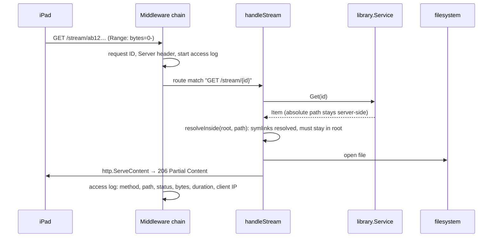

# Architecture

EinCast is a hexagonal (ports & adapters) application. See
[ADR 0001](adr/0001-hexagonal-architecture.md) for why.

## Layers

Arrows point in the direction of the import. `domain` imports nothing; `app`
never imports Wails, `net/http` or `os`. `scripts/check-deps.sh` fails if that
changes.

## What exists today (through Phase 4)

| Layer | Contents |
|---|---|
| `domain/media` | `Item`, `ID` (hash of relative path), `Kind` + extension detection, `Stats`, sentinel errors |
| `domain/server` | `State`, the transition table, and `Machine` (atomic check-and-set) |
| `app` | Ports (`Scanner`, `LibraryRepo`, `EventPublisher`, `WebServer`, `RunningServer`, `LogStream`), `LogEntry`, sealed `Event` type |
| `app/library` | `Service`: `ScanFolder`, `Summary`, `Root`, `List`, `Get` |
| `app/streaming` | `Config` + functional options, `Service`: `Start`, `Stop`, `Status`, crash watcher |
| `adapters/fsscan` | `filepath.WalkDir` scanner (skips hidden, system files, symlinks) |
| `adapters/memrepo` | `sync.RWMutex`-guarded snapshot repository |
| `adapters/httpapi` | Server lifecycle (errgroup), route table, middleware chain, handlers |
| `adapters/logbus` | `Handler` (slog decorator), `Bus` (non-blocking pub/sub), ring buffer |
| `bridge` | `App` facade, `Emitter` (event → Wails runtime), log forwarder, DTOs, startup/shutdown hooks |

### HTTP API

| Route | Response |
|---|---|
| `GET /` | Placeholder landing page (the embedded player arrives in the Connect phase) |
| `GET /api/health` | `{"status":"ok","version":"…","name":"…"}` |
| `GET /api/library` | `[{id, name, kind, size, modTime}]` (never a path) |
| `GET /api/library/{id}` | One item, or 404 |
| `GET /stream/{id}` | File bytes via `http.ServeContent`: `Range` → `206`, `HEAD`, correct `Content-Type` |
| `GET /playlist.m3u` | Extended M3U of video + audio with absolute URLs built from the request `Host` |

Errors always look like `{"error":{"code":"not_found","message":"…"}}`.
Middleware, outermost first: request ID → `Server: EinCast/<version>` → access
log → panic recovery → LAN-only CORS.

The server binds `127.0.0.1` only for now. The Connect phase adds the LAN
interface addresses (never `0.0.0.0`).

### Flow: a log line reaches the screen

The logger never waits for the UI. If the UI cannot keep up, the bus drops
entries for that subscriber and `Seq` shows the gap. `forwardLogs` is owned by
the app context and unsubscribes when it ends.

### Flow: user chooses a folder

The UI changes screens because of the *event*, not because the command
resolved: Go is the source of truth. On a webview reload the UI re-reads state
with `GetLibrarySummary()`.

### Flow: user clicks Start

If `net.Listen` fails, the service does `Fail(err)` instead and the UI shows the
reason with a "Try again" button. A server that dies later is caught by the
watcher, which moves Running → Failed.

### Flow: an iPad requests /stream/{id}

An unknown ID, a path-like ID, a deleted file, or a file that now resolves
outside the library root all end in the same JSON `404`, with the real reason
only in the log.

## Frontend

Feature-sliced: `app/` (shell), `features/` (one folder per feature),
`shared/` (bridge, glass UI, motion). Only `shared/bridge` imports the
generated `wailsjs/` code (see [ADR 0006](adr/0006-bridge-only-wails-dependency.md)).
Theming is CSS-only via `prefers-color-scheme`.
