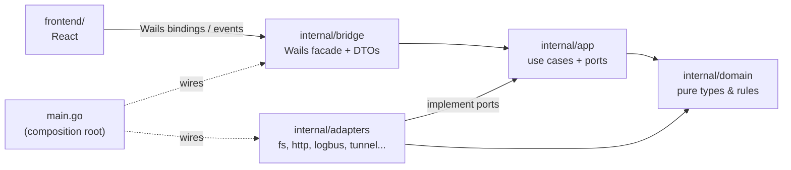
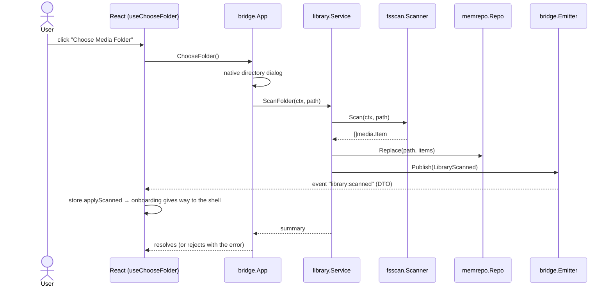

# Architecture

EinCast is a hexagonal (ports & adapters) application. See
[ADR 0001](adr/0001-hexagonal-architecture.md) for why.

## Layers

Arrows point in the direction of the import. `domain` imports nothing; `app`
never imports Wails, `net/http` or `os`. `scripts/check-deps.sh` fails if that
changes.

## What exists today (through Phase 2)

| Layer | Contents |
|---|---|
| `domain/media` | `Item`, `ID` (hash of relative path), `Kind` + extension detection, `Stats`, sentinel errors |
| `app` | Ports (`Scanner`, `LibraryRepo`, `EventPublisher`), sealed `Event` type, `LibraryScanned` |
| `app/library` | `Service`: `ScanFolder`, `Summary`, `List`, `Get` |
| `adapters/fsscan` | `filepath.WalkDir` scanner (skips hidden, system files, symlinks) |
| `adapters/memrepo` | `sync.RWMutex`-guarded snapshot repository |
| `bridge` | `App` facade (`AppInfo`, `ChooseFolder`, `GetLibrarySummary`), `Emitter` (event → Wails runtime), DTOs |

### Flow: user chooses a folder

Note the UI changes screens because of the *event*, not because the command
resolved: Go is the source of truth. On a webview reload the UI re-reads state
with `GetLibrarySummary()`.

The sequence diagrams for "user clicks Start" and "iPad requests /stream/{id}"
are added in Phase 3, when there is a flow to draw.

## Frontend

Feature-sliced: `app/` (shell), `features/` (one folder per feature),
`shared/` (bridge, glass UI, motion). Only `shared/bridge` imports the
generated `wailsjs/` code (see [ADR 0006](adr/0006-bridge-only-wails-dependency.md)).
Theming is CSS-only via `prefers-color-scheme`.
