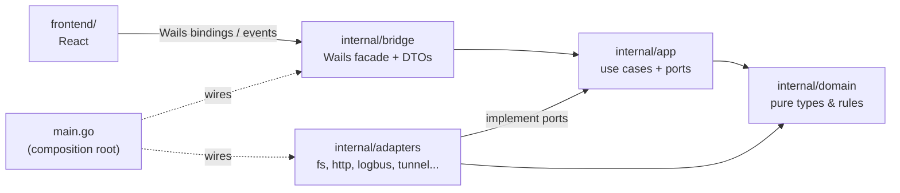
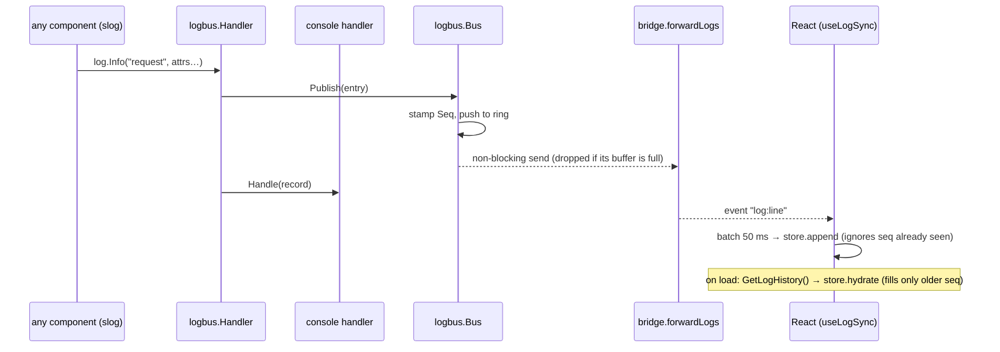
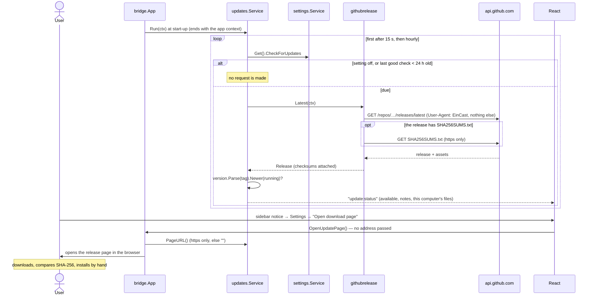
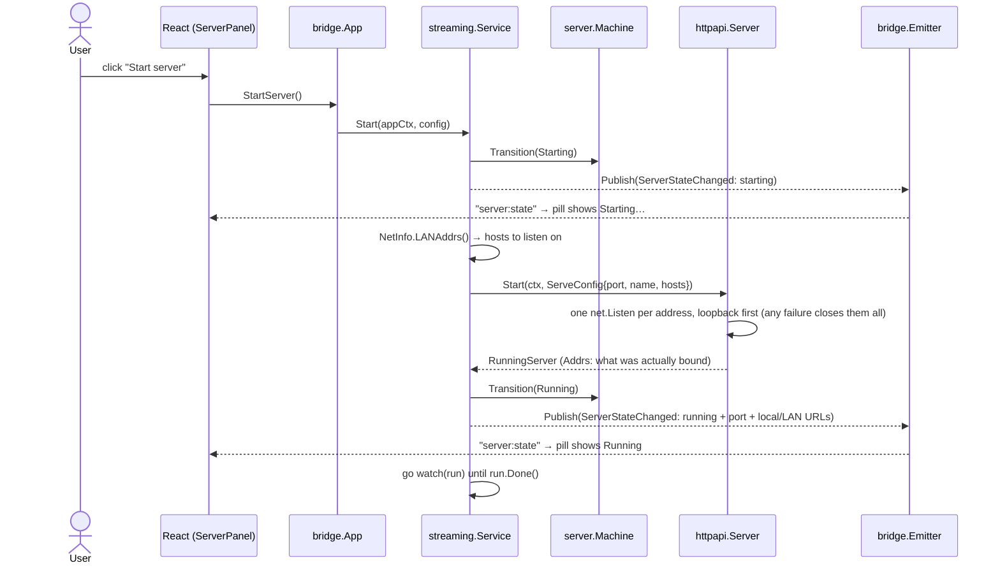
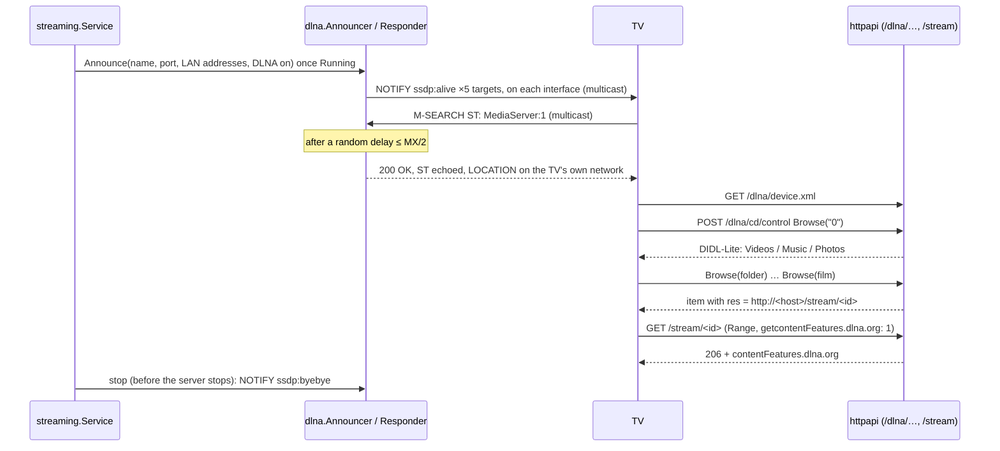
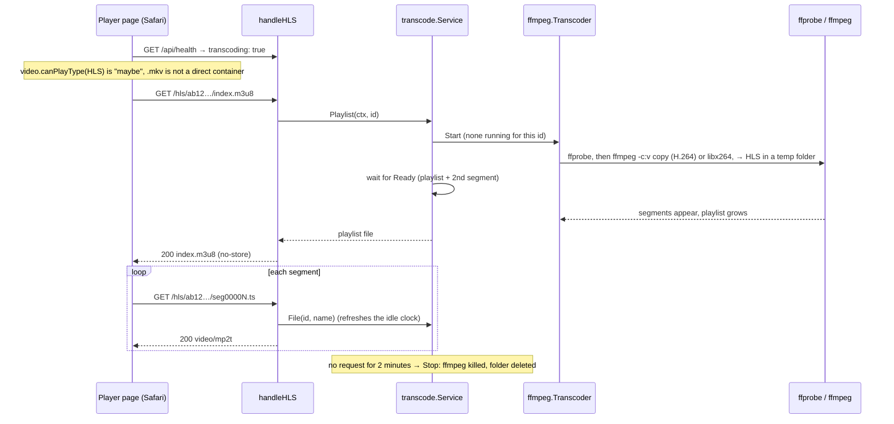

# Architecture

EinCast is a hexagonal (ports & adapters) application. See
[ADR 0001](adr/0001-hexagonal-architecture.md) for why.

## Layers



Arrows point in the direction of the import. `domain` imports nothing; `app`
never imports Wails, `net/http` or `os`. `scripts/check-deps.sh` fails if that
changes.

## What exists today (through Phase 11)

| Layer | Contents |
|---|---|
| `domain/media` | `Item`, `ID` (hash of library and relative path), `Library`/`LibraryID` (identity from the folder), `Overlaps`, `Kind` + extension detection, `Ignored` (names that are never library content), `Subtitle` + `MatchSubtitles` (sidecar rules), `Stats`, sentinel errors |
| `domain/subtitle` | `ToWebVTT`, `Decode`: SRT/VTT text to WebVTT, UTF-8/UTF-16/Windows-1252 to UTF-8 |
| `domain/server` | `State`, the transition table, and `Machine` (atomic check-and-set) |
| `app` | Ports (`Scanner`, `Discovery`, `FolderWatcher`, `FrameGrabber`, `ThumbnailCache`, `Transcoder`, `HLSStream`, `StreamProber`, `SubtitleExtractor`, `SubtitleCache`, `LibraryRepo`, `EventPublisher`, `WebServer`, `RunningServer`, `NetInfo`, `LogStream`, `SettingsStore`, `SecretStore`, `LibraryMemory`), remote-access ports and types (`Tunnel`, `LocalServer`, `TunnelRegistry`, `PublicAccess`, `RemoteStatus`), `Secret` (log-safe wrapper), `LogEntry`, sealed `Event` type |
| `app/library` | `Service`: the list of libraries — `Add`, `Remove`, `Rename`, `Rescan`/`RescanAll`, `Restore`, `State`, `List`, `Get` (one scan at a time *per library*); `Watch` supervises one watcher per library and rescans quietly after changes settle (ADRs 0014, 0021) |
| `app/transcode` | `Service`: one shared HLS conversion per video and audio track (`Playlist` waits until playable, `File`), at most two at once, idle ones swept, all stopped on exit; another track of the same video may take a slot at once (ADRs 0018, 0031) |
| `app/tracks` | `Service`: the audio and subtitle tracks inside a video (`Streams`, remembered per file version) and an embedded subtitle as WebVTT (`Subtitle`: cache → one shared ffmpeg run, two at a time) (ADR 0031) |
| `app/thumbnails` | `Service`: `Get` (cache → one shared ffmpeg attempt, two at a time, remembered failures), `Available` (ADR 0015) |
| `app/profiles` | `Service`: profiles and their PINs (PBKDF2, rate-limited `Select`), signed profile credentials, `Visible`/`TVVisible`; enforced by the HTTP layer on every route that takes an ID (ADR 0027) |
| `app/resume` | `Service`: where each profile stopped in each title, written in batches and on quit |
| `domain/version` | `Version`, `Parse`, `Compare`/`Newer`: release numbers by semantic-versioning precedence |
| `app/updates` | `Service`: asks a `ReleaseSource` whether a newer version exists (on a timer and on request), keeps the status, publishes `UpdateChanged`; never installs (ADR 0029) |
| `app/reset` | `Service`: `Erase` (login entry, credential-store entries, config and cache folders; every step runs, failures are joined) and `Relaunch`; the media folders are never touched (ADR 0034) |
| `app/settings` | `Service`: load/validate/save preferences, access token (`Required`, `Verify`, `RotateToken`); implements `LibraryMemory` |
| `app/streaming` | `Config` + functional options (port, name, DLNA), `Service`: `Start`, `Stop`, `Status`, crash watcher, `Local()` (the running server, for tunnels); announces on the network once running (`WithDiscovery`) and withdraws that, then public access, before the server stops |
| `app/providerconfig` | `Store`: a provider's saved settings in the credential store; cleans and checks values; secrets are write-only |
| `app/remote` | `Service`: `Enable` (refuses a public provider without a PIN), `Disable`, a per-run watcher, `Status`, `SetPIN`/`ClearPIN`, `Login`, session and signed-link checks, rate limiting |
| `adapters/fsscan` | `filepath.WalkDir` scanner (skips hidden, system files, symlinks); attaches sidecar subtitles, a parsed title/year/series, a `.nfo` description and a poster to videos (ADR 0026) |
| `adapters/mdns` | `Announcer`: publishes `eincast.local` and an `_http._tcp` service for exactly the announced LAN addresses (ADR 0019) |
| `adapters/dlna` | Smart TV support (ADR 0020): `Handler` (device/service descriptions, ContentDirectory Browse, ConnectionManager, events), `buildTree`/`didl`/`soap`, pure SSDP messages, the `Responder` (UDP 1900, announce, answer, goodbye) and the `Announcer` that starts it |
| `adapters/fswatch` | `fsnotify` watcher: one signal for any burst of relevant changes, follows new folders, all-or-nothing |
| `adapters/ffmpeg` | `Grabber`: one JPEG (video frame, cover art, shrunken photo). Both look for ffmpeg in the location the person chose, else on `PATH` and the usual install folders. `Transcoder`: free-space check → ffprobe → plan (copy or encode, which audio track) → HLS into a temporary folder through a chain of encoders (the video chip, then the processor), readiness polling, kill-and-delete on `Stop`. `Prober` and `Extractor`: the tracks inside a video, and one text subtitle track as WebVTT (ADRs 0031, 0032) |
| `adapters/powerguard` | `Guard`: keeps the computer awake while a run lasts; `caffeinate -i -w <pid>` on macOS, `SetThreadExecutionState` from a pinned thread on Windows (ADR 0025) |
| `adapters/eraser` | `Eraser`: removes EinCast's own config and cache folders; refuses an empty or relative path, a disk root and the home folder (ADR 0034) |
| `adapters/relaunch` | `Launcher`: starts a detached new copy with `--relaunch-after=<pid>` (`open -n` inside a macOS bundle); `WaitIfRelaunched` makes the new copy wait for the old process to exit before it takes the single-instance lock (ADR 0034) |
| `adapters/loginitem` | `Item`: opens EinCast at login; a LaunchAgent on macOS, a `Run` key value on Windows; both start with `--background` (ADR 0030) |
| `adapters/tray` | Windows notification-area icon (Open / Quit) so a hidden window can come back; nothing on macOS, where the Dock does it (ADR 0030) |
| `adapters/thumbcache` | Folder of `<key>.jpg` files in the user cache dir (or `.vtt` for extracted subtitles, `WithFiles`); atomic writes, age-based `Prune` |
| `adapters/safepath` | `Inside(root, file)`: the symlink-safe "stays in the library" check used by streaming and thumbnails |
| `adapters/memrepo` | `sync.RWMutex`-guarded snapshot repository |
| `adapters/httpapi` | Server lifecycle (errgroup, one listener per address), route table, middleware chain, handlers, embedded player page; tunnel gate (PIN sign-in, signed links, trusted forwarding headers); `Bind` for extra listeners |
| `adapters/atomicfile` | `Write`: a file replaced atomically, owner-only; used by the three stores below |
| `adapters/profilefile` | `profiles.json` (profiles and PIN hashes) beside settings.json |
| `adapters/resumefile` | `resume.json` (positions per profile) beside settings.json |
| `adapters/settingsfile` | `settings.json` in the user config dir: atomic writes, `0600`, corrupt files set aside |
| `adapters/tunnel` | Registry of tunnel providers by ID |
| `adapters/tunnel/procsup` | `Supervisor`: runs one child process, line-splits its output, restarts with backoff, kills on cancel |
| `adapters/tunnel/cloudflared` | `Quick` and `Named`: the Cloudflare tunnels, on one shared engine; `Quick` reads its address from the banner, `Named` is up on `Registered tunnel connection`; finds `cloudflared` (saved location first) |
| `adapters/tunnel/ngrok` | `Provider`: ngrok through its Go SDK, behind a small interface; reconnecting is the SDK's, ending is noticed by a watcher |
| `adapters/tunnel/tailscale` | Private provider: asks the local Tailscale for this device's address and has the server listen on it while on (ADR 0012) |
| `adapters/secrets` | OS credential store (Keychain / Credential Manager) via go-keyring; `EraseAll` empties everything filed under EinCast's service name |
| `adapters/netinfo` | LAN IPv4 detection: pure `Pick` over interfaces + the `System` reader |
| `adapters/logbus` | `Handler` (slog decorator), `Bus` (non-blocking pub/sub), ring buffer |
| `bridge` | `App` facade, `Emitter` (event → Wails runtime), log forwarder, DTOs, startup/shutdown hooks |

### HTTP API

| Route | Response |
|---|---|
| `GET /` | The device player page (embedded; list, search, `<video>`/`<audio>`/``), with a strict CSP |
| `GET /static/{file}` | The page's script, stylesheet and icon (single path segment, never a directory listing) |
| `GET /api/health` | `{"status":"ok","version":"…","name":"…","thumbnails":true,"transcoding":true,"tracks":true}` |
| `GET /api/library/{id}/tracks` | The audio and subtitle tracks inside a video: `{audio:[{index,label,lang,default}], subtitles:[{index,label,lang,supported,default}]}`; empty lists when nothing can be read |
| `GET /api/library` | The items the request's profile may see: `[{id, name, kind, size, modTime, subtitles, title, year, show, season, episode, plot, poster, legacyId}]` (never a path). 401 `profile_required` for a guest when there is more than one profile |
| `GET /api/library/{id}` | One item, or 404 (also for an item the profile may not see: the same answer as an unknown ID) |
| `GET /api/profiles` | `{active, current, profiles:[{id, name, color, hasPin}]}` for the picker; no restrictions, no hashes |
| `POST /api/profile` / `DELETE /api/profile` | Choose a profile (`{id, pin}`; sets the signed `eincast_profile` cookie, rate limited) / leave it |
| `GET /api/resume`, `PUT` / `DELETE /api/resume/{id}` | Where this profile stopped in each title it may see |
| `/dlna/…` | Only while Smart TVs is on and the token is off: `device.xml`, `cd.xml`, `cm.xml`, `cd/control`, `cm/control`, and the event URLs |
| `GET /subtitle/{id}/{n}` | Track `n` of a video as WebVTT, or 404 |
| `GET /subtitle/{id}/embedded/{n}` | Subtitle track `n` stored inside a video as WebVTT (cached), or 404 |
| `GET /hls/{id}/index.m3u8` | Starts (or joins) the HLS conversion and answers once it is playable; `/hls/{id}/seg00000.ts` serves its segments; `/hls/{id}/audio/{n}/…` is the same with the n-th audio track; `503` when busy, `507` when the disk is too full, `422` when ffmpeg cannot convert it |
| `GET /thumb/{id}` | A 320 px JPEG of the item, or a plain `404` when it has none |
| `GET /stream/{id}` | File bytes via `http.ServeContent`: `Range` → `206`, `HEAD`, correct `Content-Type` |
| `GET /playlist.m3u` | Extended M3U of video + audio with absolute URLs built from the request `Host` |

Errors always look like `{"error":{"code":"not_found","message":"…"}}`.
Middleware, outermost first: request ID → `Server: EinCast/<version>` → security
headers → access log → panic recovery → Host check → LAN-only CORS → access token
(see [ADR 0011](adr/0011-lan-access-control.md)).

The server listens on loopback plus this machine's LAN IPv4 addresses, one
explicit listener each, all on the same port. It never binds `0.0.0.0`, and the
adapter refuses to ([ADR 0009](adr/0009-lan-binding-and-interface-detection.md)).
The access token is optional and off by default; while it is off, anyone on the
same network can open the library. The Host check (DNS-rebinding defense) is
always on.

### Flow: a log line reaches the screen



The logger never waits for the UI. If the UI cannot keep up, the bus drops
entries for that subscriber and `Seq` shows the gap. `forwardLogs` is owned by
the app context and unsubscribes when it ends.

### Flow: user adds a folder

```mermaid
sequenceDiagram
    actor User
    participant UI as React (useChooseFolder)
    participant Bridge as bridge.App
    participant Svc as library.Service
    participant Scan as fsscan.Scanner
    participant Repo as memrepo.Repo
    participant Emit as bridge.Emitter

    User->>UI: click "Choose Media Folder" / "Add folder…"
    UI->>Bridge: ChooseFolder()
    Bridge->>Bridge: native directory dialog
    Bridge->>Svc: Add(ctx, path)
    Svc->>Svc: refuse the same folder or an overlapping one
    Svc->>Emit: Publish(LibraryStatusChanged: the library listed, scanning)
    Svc->>Scan: Scan(ctx, library)
    Scan-->>Svc: []media.Item (stamped with the library and its root)
    Svc->>Repo: Replace(libraryID, items)
    Svc->>Emit: Publish(LibraryScanned: every library's state)
    Emit-->>UI: events "library:status", "library:scanned" (DTOs)
    UI->>UI: store.apply → onboarding gives way to the shell; ListLibrary() re-reads the files
    Svc-->>Bridge: the library's state
    Bridge-->>UI: resolves (or rejects: already added, unreadable, …)
```

The UI changes screens because of the *event*, not because the command
resolved: Go is the source of truth. On a webview reload the UI re-reads state
with `ListLibraries()`.

### Flow: startup

```mermaid
sequenceDiagram
    participant Main as main.go
    participant Set as settings.Service
    participant File as settingsfile
    participant Key as OS credential store
    participant Lib as library.Service
    participant UI as React

    Main->>Set: Load()
    Set->>File: Load() — missing file = first run, bad file = defaults + warning
    opt token required
        Set->>Key: Get("access-token") — create one only if "not found"
    end
    Main->>Main: wails.Run → OnStartup
    par background, owned by the app context
        Main->>Lib: Restore(ctx): rescan every remembered library
        Lib-->>UI: "library:status" scanning → "library:scanned" (or an error status)
    and
        UI->>Main: ListLibraries / GetSettings / GetServerState
    end
    UI->>UI: scanning → "Scanning…" screen; failed → "Can't open your library"; done → dashboard
```

### Flow: EinCast looks for a newer version



"Check now" calls `Check` directly and skips the setting and the 24 h rule: it is the
person asking.

### Flow: a phone joins from the QR code

```mermaid
sequenceDiagram
    actor User
    participant Card as ConnectCard (React)
    participant Phone
    participant MW as Middleware chain
    participant Page as handleIndex + handleStatic
    participant API as handleLibrary / handleStream

    Card->>Card: lanUrls[0] (+ ?t=token when protected) → QR code + copyable URL
    User->>Phone: scans the QR code
    Phone->>MW: GET http://192.168.1.20:8765/?t=…
    MW->>MW: Host check, then token check
    MW-->>Phone: 303 to / + HttpOnly cookie (token leaves the address bar)
    Phone->>MW: GET /
    MW->>Page: security headers + CSP
    Page-->>Phone: index.html (embedded)
    Phone->>MW: GET /static/app.js, /static/style.css
    Phone->>API: GET /api/health, /api/library
    API-->>Phone: JSON (ids, names, kinds, sizes; never paths)
    Phone->>Phone: renders the list as text (never as HTML)
    Phone->>API: GET /stream/{id} (Range) when an item is tapped
```

### Flow: user clicks Start



If `net.Listen` fails, the service does `Fail(err)` instead and the UI shows the
reason with a "Try again" button. A server that dies later is caught by the
watcher, which moves Running → Failed.

### Flow: an iPad requests /stream/{id}


An unknown ID, a path-like ID, a deleted file, or a file that now resolves
outside the library root all end in the same JSON `404`, with the real reason
only in the log.

### Flow: files change on disk

```mermaid
sequenceDiagram
    participant FS as filesystem
    participant W as fswatch.Watcher
    participant Lib as library.Service.Watch
    participant Sc as fsscan.Scanner
    participant UI as Library screen

    Note over Lib: a scan finished → announces its root; Watch starts watching it
    Lib->>W: Watch(ctx, root)
    FS-->>W: events (create, write, write, write …)
    W->>W: drop hidden / non-media / chmod; add watches for new folders
    W-->>Lib: one signal (bursts coalesce)
    Note over Lib: wait until quiet for 2 s, but at most 30 s
    Lib->>Sc: Scan(root)  (quiet: no "Scanning…" status)
    alt same files, sizes and times
        Lib->>Lib: say nothing
    else changed
        Lib->>UI: "library:scanned" → UI asks ListLibrary()
    end
```

If the folder cannot be watched (the system's limit), `Status().Watching` is false
and the Library screen says changes need Rescan ([ADR 0014](adr/0014-watch-the-library-folder.md)).

### Flow: a thumbnail is requested

```mermaid
sequenceDiagram
    participant C as Player page / Library row
    participant H as handleThumbnail / bridge.GetThumbnail
    participant T as thumbnails.Service
    participant K as thumbcache
    participant F as ffmpeg.Grabber

    C->>H: GET /thumb/ab12…  (or GetThumbnail("ab12…"))
    H->>T: Get(ctx, id)
    T->>T: library lookup → item, cache key (id, size, mtime, version)
    T->>K: Get(key)
    alt cached
        K-->>T: JPEG
    else not cached
        T->>T: join the running attempt for this key, or start one (2 at a time, 30 s)
        T->>F: Grab(ctx, root, path, width 320)
        F->>F: safepath.Inside(root, path), then run ffmpeg
        F-->>T: JPEG, or "no thumbnail"
        T->>K: Put(key, JPEG)
    end
    T-->>H: JPEG
    H-->>C: image/jpeg (HTTP) or a data: URL (bridge); 404 / "" when there is none
```

### Flow: a smart TV finds and plays a film



### Flow: an iPhone plays an MKV



If direct playback of a file fails instead (an MP4 with HEVC), the page retries once
through the same route ([ADR 0018](adr/0018-hls-conversion-on-demand.md)).

In Firefox (and any browser that cannot play HLS itself) the same flow runs with one
change: the page loads `/static/hls.min.js` and gives the `<video>` to hls.js, which
fetches the playlist and segments with XHR from the same routes. Picking another audio
track asks for `/hls/{id}/audio/{n}/index.m3u8` instead, and picking an embedded
subtitle adds a `<track>` for `/subtitle/{id}/embedded/{n}`
([ADR 0031](adr/0031-playback-gaps-hlsjs-and-embedded-tracks.md)). ffmpeg tries the
video chip first and the processor if the chip fails
([ADR 0032](adr/0032-hardware-encoding-and-disk-safety.md)).

### Flow: the user turns on Tailscale

```mermaid
sequenceDiagram
    participant UI as Remote screen
    participant B as bridge.App
    participant S as streaming.Service
    participant R as remote.Service
    participant T as tailscale.Provider
    participant CLI as tailscale CLI
    participant Srv as httpapi running server

    UI->>B: EnableRemote("tailscale")
    B->>S: Local()
    S-->>B: running server (or ErrServerNotRunning → "Start the server first.")
    B->>R: Enable(ctx, "tailscale", server)
    R->>R: private provider: no PIN needed; state Starting; publish
    R->>T: Start(lifetime ctx, server)
    T->>CLI: tailscale status --json
    CLI-->>T: BackendState Running, 100.x.y.z, den.tailnet.ts.net
    T->>T: address must be inside 100.64.0.0/10 or fd7a:115c:a1e0::/48
    T->>Srv: Bind(100.x.y.z)
    Srv-->>T: unbind func (listener on the server's port)
    T-->>R: http://den.tailnet.ts.net:8765
    R->>R: register URL for the Host check; state Running; publish
    R-->>UI: "remote:status" → Connect card gets a Tailscale tab
```

Turning it off (or stopping the server, or cancelling the lifetime context)
calls the `unbind` function, which closes the listener and the connections that
arrived through it. Requests from a tailnet device reach the same middleware
chain as a LAN device: the peer is a `100.x` address, not loopback, so the access
token (if enabled) applies and the log shows the device's real address.

### Flow: the quick tunnel starts, restarts and stops

```mermaid
sequenceDiagram
    participant R as remote.Service
    participant Q as cloudflared.Quick
    participant S as procsup.Supervisor
    participant P as cloudflared process

    R->>Q: Start(lifetime ctx, server)
    Q->>S: Start(ctx)  [cloudflared tunnel --no-autoupdate --url http://127.0.0.1:port]
    S->>P: spawn
    P-->>S: stderr lines (banner)
    S-->>Q: OnLine for each line
    Q->>Q: first https://<words>.trycloudflare.com of this run (never api.…)
    Q-->>R: URL (Start returns)
    loop every second while the run lasts
        R->>Q: Status()
    end
    P--xS: exits unexpectedly
    S-->>Q: OnExit(err, restarting=true)  → Status: Starting (reconnecting)
    S->>S: wait 1s, 2s, 4s … (max 5 in a row)
    S->>P: spawn again
    P-->>S: banner with a NEW address
    S-->>Q: OnLine → Status: Running, new URL
    R->>R: sees the new URL: Host check now accepts it, refuses the old; publishes
    Note over R,P: if it keeps failing, the supervisor gives up → Status: Failed →<br/>the service stops the provider and takes remote access down
    R->>S: Stop  (Disable, server stop or lifetime end)
    S->>P: interrupt, then kill after 5s
    S-->>R: Done closed once the process is gone
```

### Flow: setting up and starting the named tunnel

```mermaid
sequenceDiagram
    participant UI as Remote screen
    participant B as bridge.App
    participant R as remote.Service
    participant C as providerconfig.Store
    participant K as OS keychain
    participant N as cloudflared.Named
    participant S as procsup + cloudflared

    UI->>B: SetRemoteProviderField("cloudflare-named", "hostname", "https://Media.Example.com/")
    B->>R: SetProviderField
    R->>R: refuse if this provider is on
    R->>C: Set (provider's Clean: → media.example.com)
    C->>K: store provider/cloudflare-named/hostname
    R-->>UI: "remote:status" (needsSetup updated)
    UI->>B: SetRemoteProviderField(…, "token", "eyJ…")
    Note over B,K: the same path; the token is stored, then only "set" is ever reported back
    UI->>B: EnableRemote("cloudflare-named")
    B->>R: Enable
    R->>C: Missing? → none · PIN set? → yes
    R->>N: Start(lifetime, server)
    N->>C: Get token, hostname, binary
    N->>S: run: tunnel --no-autoupdate run   env TUNNEL_TOKEN=…   (secrets scrubbed from output)
    S-->>N: line: "Registered tunnel connection"
    N-->>R: https://media.example.com
    R-->>UI: "remote:status" → running
```

### Flow: a request arrives through a public tunnel

The tunnel (a `cloudflared` process, say) runs on this machine and forwards
internet traffic to `127.0.0.1`, so the server sees a loopback connection with
forwarding headers. Everything below is in the middleware chain, before any
handler runs. Decisions and rejected alternatives are in
[ADR 0008](adr/0008-public-access-requires-authentication.md).

```mermaid
sequenceDiagram
    participant Web as Browser / VLC on the Internet
    participant T as Tunnel process (loopback)
    participant MW as Middleware chain
    participant R as remote.Service
    participant H as Handler

    Web->>T: GET https://abc.trycloudflare.com/ (no cookie)
    T->>MW: GET / from 127.0.0.1, Host: abc…, X-Forwarded-For: client
    MW->>R: HostAllowed("abc…")?
    R-->>MW: yes, the online tunnel
    MW->>MW: viaTunnel? peer is loopback and (public active or forwarding headers): yes
    MW->>R: ValidSession(cookie)? / VerifyStream(id, exp, sig)?
    R-->>MW: no
    MW-->>Web: 401 + PIN sign-in page (no script allowed)

    Web->>T: POST /login (pin)
    T->>MW: same path; clientIP = last X-Forwarded-For entry (trusted: peer is loopback)
    MW->>R: Login(client ip, pin)
    R->>R: per-address and global token buckets; scrypt compare
    R-->>MW: session token (or wrong PIN / locked out)
    MW-->>Web: 303 → /, Set-Cookie: eincast_session (HttpOnly, SameSite=Lax)

    Web->>T: GET /playlist.m3u (cookie)
    MW->>H: valid session → handler
    H->>R: SignStream(id) for each item
    H-->>Web: M3U with /stream/{id}?exp=…&sig=… (https, from X-Forwarded-Proto)
    Note over Web,H: VLC then plays each link with no cookie: the signature covers the item and the expiry
```

Disabling remote access (or stopping the server, which disables it first)
rotates the keys: every session and link stops working at once.

## Frontend

Feature-sliced: `app/` (shell), `features/` (one folder per feature),
`shared/` (bridge, glass UI, motion). Only `shared/bridge` imports the
generated `wailsjs/` code (see [ADR 0006](adr/0006-bridge-only-wails-dependency.md)).
Theming is CSS plus one attribute: tokens follow `prefers-color-scheme` unless
the Appearance setting puts `data-theme` on `<html>`
([ADR 0016](adr/0016-manual-theme-over-a-native-backdrop.md)).
