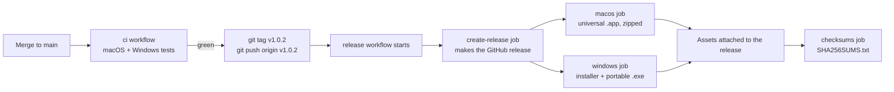

# Releasing EinCast

How a new version gets from `main` to a download page. Read this once, then use the [checklist](#4-release-checklist) each time.

**The short version:** make sure CI is green on `main`, push a tag like `v1.0.2`, and GitHub Actions builds the macOS and Windows apps and publishes the release. You do not build anything on your own machine.

---

## 1. How it works



Two workflows live in [.github/workflows/](../.github/workflows/):

| Workflow | Trigger | What it does |
|---|---|---|
| [ci.yml](../.github/workflows/ci.yml) | every push to `main`, every pull request | Frontend typecheck + tests, `go vet`, dependency rules, `go test` (with `-race` on macOS), cross-compile check, a full `wails build`. Runs on **macOS and Windows**. |
| [release.yml](../.github/workflows/release.yml) | pushing a tag that starts with `v` | Creates the GitHub release, then builds and uploads the apps. Does **not** run the tests, which is why you wait for green CI before tagging. |

### What a release contains

| File | For |
|---|---|
| `eincast-<version>-macos-universal.zip` | Mac, Intel and Apple Silicon (`eincast.app`) |
| `eincast-<version>-windows-amd64-installer.exe` | Windows installer (NSIS) |
| `eincast-<version>-windows-amd64.exe` | Windows portable, no install |
| `SHA256SUMS.txt` | The SHA-256 of the three files above, written by the last job (`shasum -a 256 -c SHA256SUMS.txt`). **The app's update check reads this exact name** to show checksums, so do not rename it. If a release ever has more or fewer than three files, change the `-eq 3` guard in the `checksums` job. |

GitHub also adds "Source code (zip)" and "Source code (tar.gz)" to every release. Those are the repo, not the app.

### Where the version number comes from

**The git tag is the single source of truth.** The release workflow reads it and:

- stamps it into the binary with `-ldflags "-X main.version=<version>"`. This is what the window title, the About screen, the HTTP `Server` header and the DLNA announcement show;
- writes it into `wails.json` (`info.productVersion`) inside the CI job, for the Windows installer and the macOS `Info.plist`. A suffix such as `-rc1` is dropped there, because those need a plain `x.y.z`.

So you do not have to edit `main.go` or `wails.json` for the release to be correct. We still keep `wails.json` and `frontend/package.json` in step (see the checklist) so the repo does not look stale.

---

## 2. Version numbers

Tags are `v` + three numbers: `vMAJOR.MINOR.PATCH`. Our convention:

| Change | Rule | Example |
|---|---|---|
| Bug fix, small tweak | last number +1 | `v1.0.1` → `v1.0.2` |
| New feature | middle number +1, last number back to **1** | `v1.0.2` → `v1.1.1` |
| Major / breaking change | first number +1, middle back to **0**, last back to **1** | `v1.1.4` → `v2.0.1` |
| Release candidate | add a suffix | `v1.1.1-rc1` |

Notes:

- A tag with a `-` in it (like `-rc1`) is published as a **pre-release** automatically and is not marked "Latest".
- Always three numbers. The Windows installer rejects anything else.
- Tags are permanent history. Never reuse a version number once people could have downloaded it; ship the next number instead.

---

## 3. One-time setup

Nothing is needed to run a release: the workflow uses the `GITHUB_TOKEN` GitHub provides, and there are no secrets to configure.

Useful to have locally (all optional):

| Tool | Why |
|---|---|
| Go (version in `go.mod`), Node 22, Wails v2.12.0 | Reproduce CI locally: `go install github.com/wailsapp/wails/v2/cmd/wails@v2.12.0` |
| GitHub CLI `gh` (`brew install gh`, then `gh auth login`) | Watch runs and inspect releases from the terminal. Without it, use the Actions tab in the browser. |

---

## 4. Release checklist

Replace `1.0.2` with your version.

### Step 1: Be on a clean, up-to-date `main`

```sh
git checkout main
git pull --ff-only
git status            # must say "nothing to commit, working tree clean"
```

### Step 2: Run the same checks CI runs

```sh
(cd frontend && npm ci && npm run typecheck && npm test && npm run build)
go vet ./...
scripts/check-deps.sh                 # hexagonal dependency rules
go test -race -count=1 ./...
scripts/check-cross.sh                # compiles for macOS and Windows
```

Optional but recommended: build the app and open it.

```sh
wails build -clean -ldflags "-X main.version=1.0.2"
open build/bin/eincast.app
```

### Step 3: Bump the version in the repo

Keep these two in step with the tag:

- `wails.json` → `info.productVersion`
- `frontend/package.json` → `version`, and the two matching `"version"` lines at the top of `frontend/package-lock.json`

(The README and the comment above `var version` in `main.go` only show example version numbers; they do not need to change.)

```sh
git add -A
git commit -m "chore: release v1.0.2"
git push origin main
```

### Step 4: Wait for CI to go green on that commit

Open the **Actions** tab, or:

```sh
gh run list --workflow ci --limit 3
gh run watch
```

It takes about 5 minutes. **Do not tag a red commit.** The release workflow builds whatever you tag and does not run the tests.

### Step 5: Tag and push

```sh
git tag -a v1.0.2 -m "EinCast v1.0.2"
git push origin v1.0.2
```

That is the whole release trigger. There is nothing to click on GitHub.

### Step 6: Watch the release build

```sh
gh run list --workflow release --limit 3
gh run watch
```

Or the **Actions** tab → **release**. Expect about 10 to 15 minutes. The macOS job usually finishes first.

### Step 7: Verify

On `https://github.com/bkjonathan/ein-cast/releases/tag/v1.0.2`:

- [ ] The release is marked **Latest** (or Pre-release for `-rc` tags).
- [ ] All three files and `SHA256SUMS.txt` are listed under Assets (the checksums appear a minute after the builds).
- [ ] The notes read well (What's new, Fixes, Known limits).
- [ ] An older EinCast, pointed at this release, shows "Update available" (Settings → Updates → Check now) with the checksums.
- [ ] Download the Mac zip, unzip, open the app, check the version in the window title.
- [ ] On a Windows machine, run the installer (or the portable exe) and check the version.

```sh
gh release view v1.0.2        # lists the assets from the terminal
```

### Step 8: Edit the notes (optional)

The release notes are written by [scripts/release-notes.sh](../scripts/release-notes.sh) from the commit subjects since the previous tag: `feat:` (and any subject that is not in `type: text` form) under **What's new**, `fix:` under **Fixes**, and nothing for `chore`, `docs`, `test`, `ci`, `build`, `refactor`, `style`, `perf`. **Known limits** is the file [.github/release-known-limits.md](../.github/release-known-limits.md); edit it when a limit appears or goes away (delete the unsigned-builds paragraph when signing lands). Preview the notes before you tag:

```sh
scripts/release-notes.sh HEAD
```

To add highlights afterwards, edit the release on GitHub (pencil icon) or `gh release edit v1.0.2 --notes-file notes.md`. The commit subjects become public text, so write them for a reader.

---

## 5. Telling users how to open an unsigned app

The apps are **not code-signed yet** (signing is a v1.0 item in [ROADMAP.md](ROADMAP.md)), so each OS warns on first launch. The release notes already say this; repeat it in any announcement.

- **macOS:** unzip, then in Terminal run `xattr -dr com.apple.quarantine eincast.app`. Alternatively right-click the app and choose **Open** the first time.
- **Windows:** SmartScreen shows "Windows protected your PC". Click **More info**, then **Run anyway**.

---

## 6. When something goes wrong

### CI is red before you tag

Fix it on `main`, push, and wait for green. Do not tag.

Windows failures that are not real bugs usually come from tests written on a Mac. Things that have bitten us:

- **Hard-coded Unix paths.** `media.NewLibrary("/media/films")` cleans the path, which on Windows turns it into `\media\films`. A fake keyed by the literal `"/media/films"` then never matches. Wrap test paths with `filepath.FromSlash` (the library tests have a small `p()` helper for this) or compare against `media.NewLibrary(x).Root`.
- **File names Windows forbids.** A name containing a newline, `:`, `?`, `"` and so on cannot be created on Windows. Put the name on the in-memory item instead of creating a real file.
- **File-change notifications.** Windows reports a change to an open file only after the handle is closed. Close the file in the test before waiting for the watcher.

The Windows CI step has a 4-minute timeout and prints failing test lines as annotations on the run summary page, so a failure shows up quickly and readably.

### The release workflow fails

Open the failed run in the Actions tab and read the failing step.

- **A transient failure** (runner glitch, network): re-run only the failed jobs. Uploads use `--clobber`, so files that were already attached are replaced, not duplicated.
  ```sh
  gh run rerun <run-id> --failed
  ```
  or the "Re-run failed jobs" button in the browser.
- **A real build error** that needs a code change: see "Redo a release" below.

### Redo a release

Only do this if **nobody has downloaded the release yet**. Redoing a published version confuses anyone who already has it; in that case just ship the next number.

1. Fix the problem on `main`, push, and wait for green CI.
2. Delete the release and the tag, then tag again on the new commit:
   ```sh
   gh release delete v1.0.2 --cleanup-tag --yes     # removes release + remote tag
   git tag -d v1.0.2                                # removes the local tag
   git tag -a v1.0.2 -m "EinCast v1.0.2"
   git push origin v1.0.2
   ```
   Without `gh`: delete the release in the browser, then
   ```sh
   git push origin :refs/tags/v1.0.2
   git tag -d v1.0.2
   ```
   and tag again as above.

### A released version has a serious bug

Do not delete a release people have downloaded. Fix the bug and ship the next patch (`v1.0.3`). If the bad release is dangerous, edit its notes to say "do not use, fixed in v1.0.3".

### "I only see source code, no app files"

The builds are still running. The release page appears first and the app files are attached as each platform finishes. Check the **release** run in the Actions tab. Only the files named `eincast-…` are the app.

### `gh` says "API rate limit exceeded" (or scripts polling GitHub without logging in)

Unauthenticated GitHub API calls are limited to 60 per hour. Run `gh auth login`, or wait for the limit to reset.

---

## 7. Reference

| Thing | Value |
|---|---|
| Release trigger | Push a tag matching `v*` |
| Version stamped into the app | `-ldflags "-X main.version=<tag without v>"` |
| Wails version (CI) | v2.12.0 |
| Go version | from `go.mod` |
| Node version (CI) | 22 |
| macOS build | `wails build -clean -platform darwin/universal` |
| Windows build | `wails build -clean -platform windows/amd64 -nsis` (NSIS installed by the workflow) |
| macOS packaging | `ditto` zip, which keeps the app bundle's symlinks and permissions; a plain `zip` corrupts the `.app` |
| Pre-release detection | any tag containing `-` |
| Permissions | the workflow requests `contents: write`; no personal tokens or secrets |
| Signing | none yet; planned for v1.0 in [ROADMAP.md](ROADMAP.md) |
| Update check | the app reads `/releases/latest` of this repository (final releases only; a tag with `-` is a pre-release and is never offered) and `SHA256SUMS.txt`; see [ADR 0029](adr/0029-update-notice-from-github-releases.md) |
